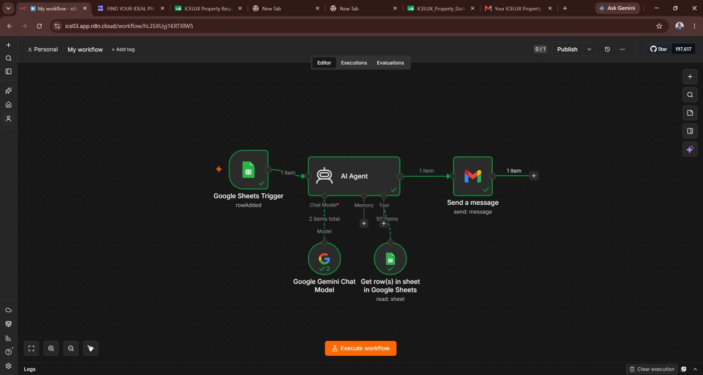
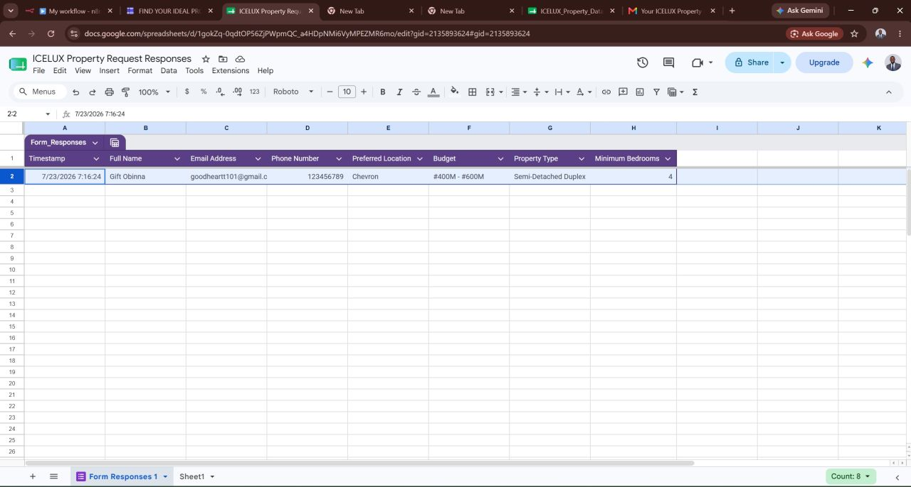
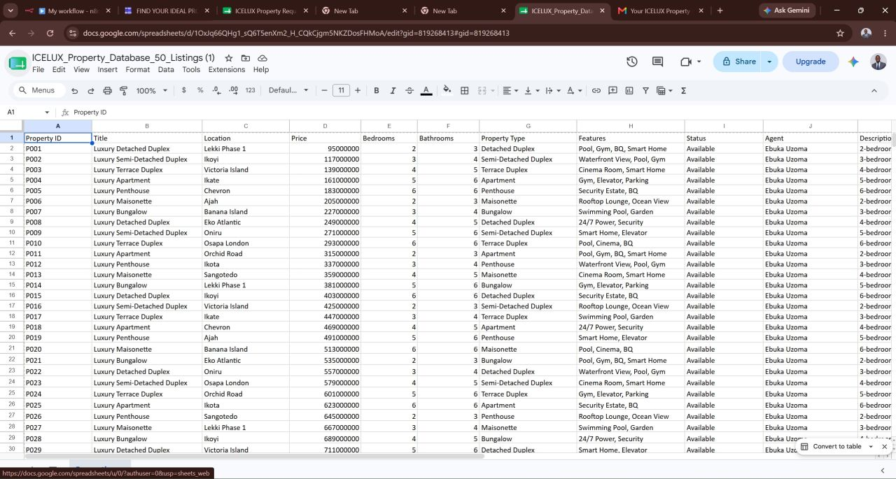
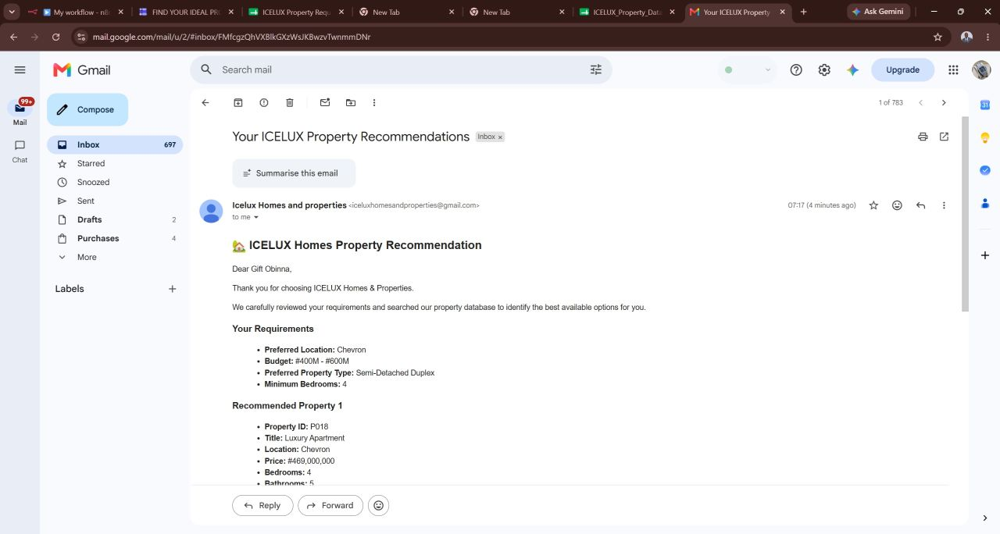

# AI Property Recommendation & Email Automation

An AI-powered workflow that matches customer property requirements with suitable listings and delivers personalized recommendations by email.

## Project Overview

Real estate agents often spend time reviewing property listings, matching them to customer requirements, and preparing individual responses.

This project automates that process using n8n, Google Gemini, and Google Workspace tools.

## How It Works

1. A customer submits their property requirements through Google Forms.
2. The form responses are stored in Google Sheets.
3. n8n processes the submission and passes the customer's requirements to an AI agent.
4. The AI agent uses the property database to identify suitable listings.
5. The workflow generates a personalized HTML email containing the property recommendations.
6. Gmail sends the recommendations to the customer's email address.

## Key Features

- Automated property enquiries
- AI-assisted property matching
- Property database lookup
- Personalized HTML email generation
- Automated email delivery
- Reduced manual work for real estate agents

## Technologies Used

- n8n — Workflow automation
- Google Gemini — AI-powered property recommendation
- Google Forms — Customer requirement collection
- Google Sheets — Property database and form responses
- Gmail — Personalized email delivery

## Business Value

This workflow demonstrates how AI and automation can reduce repetitive work, speed up property recommendations, and help real estate teams respond to customer enquiries more efficiently.

## Future Improvements

- WhatsApp integration
- CRM integration
- Automated inspection scheduling
- Property image delivery
- Lead follow-up automation

## Disclaimer

This project is a portfolio demonstration. Sample property data may be used, and the workflow is not presented as a production deployment.
## Project Screenshots

### Workflow

### Google Form Responses

### Property Database

### Recommendation Email

## 🎥 Project Demo
[Watch the full demo on LinkedIn] (https://www.linkedin.com/posts/ebuka-uzoma-10a301191_aiautomation-n8n-artificialintelligence-activity-7487582304488366081-gOws?utm_source=share&utm_medium=member_ios&rcm=ACoAAC0Su1oB4TYdyugpY1hy5D-D8w4_vleMBX4